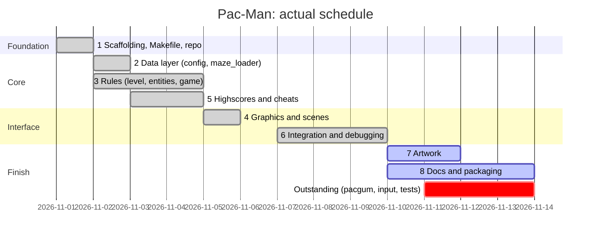

I. Project Content
(1): Basic Project Setup and Configuration Guidelines

- [x] .gitignore: Ignore __pycache__/, .mypy_cache/, venv/, build/, dist/, and locally generated high-score files.
- [x] Makefile: An automation script that defines rules for `install`, `run`, `debug`, `clean`, `lint`, and `lint-strict`; the `install` rule must include the installation command for the assigned A-Maze-ing package.
    - [ ] Check for alternative methods using wildcards
- [x] requirements.txt: pygame, flake8, mypy, pyinstaller, and the assigned A-Maze-ing package.
- [ ] pac-man.py: Entry script in the root directory; it only checks the number of arguments before calling pacman.app.main().
- [ ] pacman/ skeleton: Create an empty package directory with __init__.py, as well as the entities/ and scenes/ subdirectories.
- [ ] project_management/timeline.md: Gantt chart or Kanban board showing start and end dates for the six phases.
- [ ] project_management/analysis.md: Technical selection rationale, including a function comparison table for pygame and MLX.
- [ ] project_management/risks.md: Risks and mitigation strategies.
- [ ] project_management/team.md: Record of task assignments, as well as procedures for handling decisions and disputes.

(II) Data Layer and External Package Integration
- [ ] pacman/constants.py: Default values, colors, grid pixel size, and direction enumerations.
- [ ] pacman/config.py: First remove #-commented lines, then use `json.loads` to load the file and output the `Config` dataclass; perform type and range validation on each key; revert to default values and print a warning for invalid values; ignore unknown keys; do not raise any tracebacks throughout the process.
- [ ] config.json: An annotated default configuration template; key names correspond one-to-one with the “Configuration” section in the README.
- [ ] pacman/maze_loader.py: MazeLoader.generate(width, height, seed) → Grid, PERFECT=False; all calls to the other module are wrapped in a try/except block; after loading, calculates the set of reachable cells and excludes the enclosed “42” pattern area.
- [ ] tests/test_config.py, tests/test_maze_loader.py.

(3) Core Gameplay Logic
- [ ] pacman/level.py: Places dots on reachable grid cells; places super dots and ghost spawn points at the four corners; sets the player’s spawn point to the reachable grid cell closest to the geometric center.
- [ ] pacman/entities/base.py: Base class for entities; handles grid coordinates, orientation, and movement steps.
- [ ] pacman/entities/player.py: Wall collision detection, turning buffer, and bean-eating detection.
- [ ] pacman/entities/ghost.py: Three-state machine (CHASE / FRIGHTENED / DEAD); uses BFS to determine the next move during pursuit; selects the neighbor farthest from the player when fleeing; after being eaten, counts down and respawns in its own corner.
- [ ] pacman/game.py: Score only increases, never decreases; lives and score are carried over between levels; Level 1 has a fixed seed, while subsequent levels are randomized; level timer and timeout handling.

- [ ] tests/test_level.py, test_ghost.py, test_game.py (A).
By the end of this phase, finalize the three interfaces: Config, Grid, and the game-over result object.

(4) Graphics and User Interface
- [ ] pacman/gfx.py: The only module that interacts with pygame; it encapsulates the window, textures, text, event polling, and frame rate; No other modules should import pygame.
- [ ] pacman/renderer.py: Converts grid coordinates to pixels; draws wall tiles, the Pac-Man, entities, and the HUD (score, lives, level, remaining time).
- [ ] pacman/scenes/base.py: Scene interface with handle_key, update, and draw methods.
- [ ] pacman/scenes/play.py: Gameplay scene.
- [ ] pacman/app.py: Scene manager and main loop.
- [ ] pacman/scenes/menu.py, instructions.py, scores.py, pause.py (B): Main menu (Start, High Scores, Instructions, Exit) and pause menu (Continue, Return to Main Menu).
- [ ] assets/

(5) High Scores and Cheats
- [ ] pacman/highscores.py: Tolerates missing or corrupted files; filenames are limited to 10 characters and must consist only of alphanumeric characters and spaces; stores the top ten scores; uses `with` for file operations.
- [ ] pacman/scenes/name_entry.py: Also serves as the victory and defeat screens; displays the final score and handles saving.
- [ ] pacman/cheats.py: Invincibility, skip level, freeze ghosts, extra lives, speed boost; write key bindings to the instructions page; skip level has the highest priority.
- [ ] tests/test_highscores.py.

(VI) Finalization and Release
- [ ] pacman.spec (B): PyInstaller specification; bundle assets/, default configuration, and documentation; Use `sys._MEIPASS` to handle resource paths, upload to itch.io and set it to “Unlisted,” and practice repackaging on the spot.
- [ ] README.md (each module writes its own): Italicized author credit on the first line; includes Description, Instructions, Resources (including AI usage instructions), Configuration, Highscore, Maze Generation, Implementation, General Software, Architecture, and Project Management—all in English.
- [ ] project_management/progress.md: Actual progress compared to the plan.
- [ ] project_management/test_plan.md: Acceptance test cases, bugs found and fixed.
- [ ] project_management/issues.md: Blockers and records of disagreements.

# Timeline

Plan and actual, by phase. Dates are 2026.

| Phase | Planned | Actual | Deliverables |
| --- | --- | --- | --- |
| 1 | day 1 | to 2 Nov | `.gitignore`, `Makefile`, `requirements.txt`, `setup.cfg`, skeleton |
| 2 | days 2-3 | 2-3 Nov | `constants.py`, `config.py`, `maze_loader.py`, tests |
| 3 | days 3-5 | 2-5 Nov | `level.py`, `entities/`, `game.py` |
| 4 | days 5-7 | 5-6 Nov | `gfx/`, `scenes/`, `app.py` |
| 5 | days 6-8 | 3-5 Nov | `highscores.py`, `cheat.py`, `name_entry.py` |
| 6 | days 8-9 | 7-10 Nov (overran) | integration; `make run` as first check |
| 7 | last | from 10 Nov | placeholder art done, final art open |
| 8 | last | from 10 Nov | docs written; `pacman.spec`, `make package`, itch.io open |

Outstanding: apply `config.pacgum`; hold-to-move input; maze size ceiling;
broken-config set on a school machine; rebuild drill.